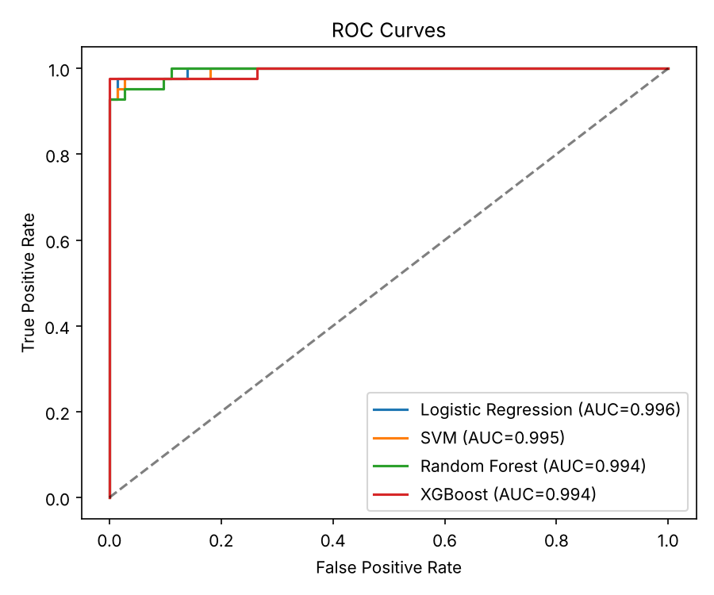
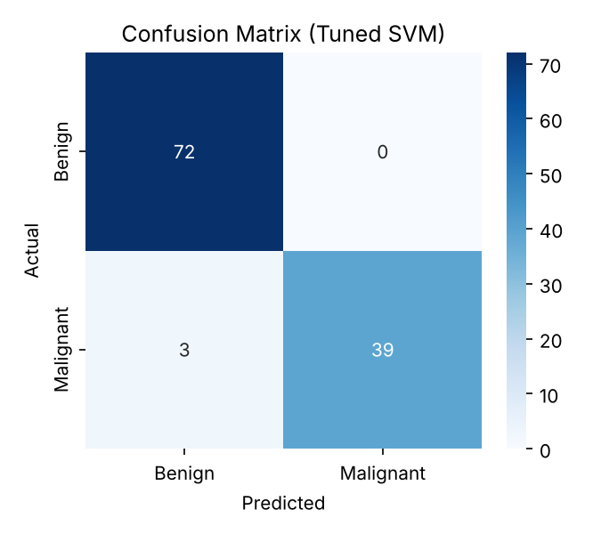
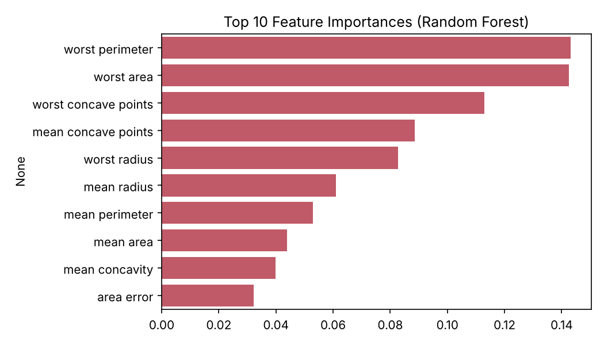
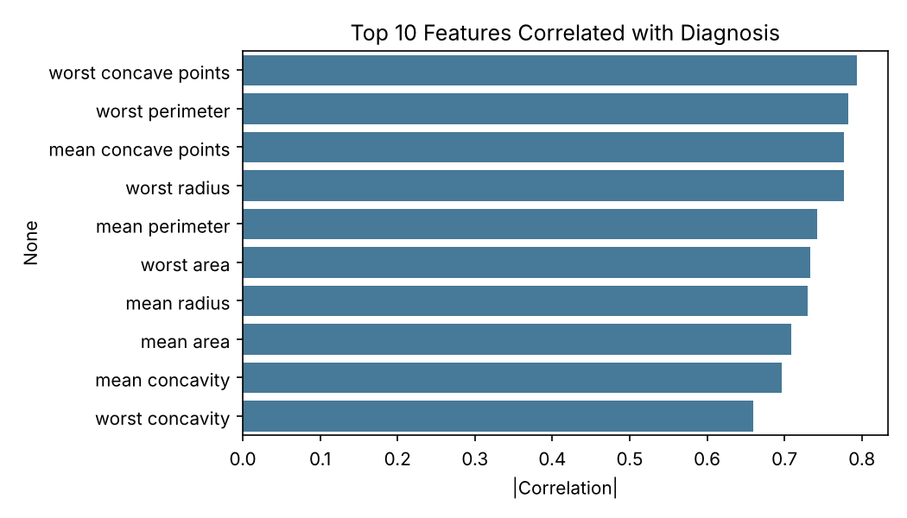

# CodeAlpha Task 4: Disease Prediction from Medical Data

Machine Learning Internship project for [CodeAlpha](https://www.codealpha.tech).

## Objective
Predict whether a tumour is **malignant or benign** from patient diagnostic measurements, using classification algorithms on structured medical data.

## Dataset
**Breast Cancer Wisconsin (Diagnostic)** from the UCI ML Repository (bundled with scikit-learn).
- 569 patients, 30 numeric features (radius, texture, perimeter, area, concavity, etc., each as mean / standard error / worst)
- Target: `1` = malignant (212), `0` = benign (357)
- No missing values

## Approach
1. Exploratory analysis (class balance, feature correlations)
2. Stratified 80/20 train/test split
3. Feature scaling (StandardScaler) for Logistic Regression and SVM
4. Trained four models: **Logistic Regression, SVM, Random Forest, XGBoost**
5. Evaluated with Accuracy, Precision, Recall, F1-Score, ROC-AUC and 5-fold cross-validation
6. Hyperparameter tuning of the SVM with GridSearchCV
7. Feature importance analysis

## Results (test set, 114 patients)

| Model | Accuracy | Precision | Recall | F1-Score | ROC-AUC |
|---|---|---|---|---|---|
| Logistic Regression | 0.9649 | 0.9750 | 0.9286 | 0.9512 | 0.9960 |
| SVM | 0.9737 | 1.0000 | 0.9286 | 0.9630 | 0.9947 |
| Random Forest | 0.9737 | 1.0000 | 0.9286 | 0.9630 | 0.9944 |
| XGBoost | 0.9649 | 1.0000 | 0.9048 | 0.9500 | 0.9937 |

**Tuned SVM** (`C=100, gamma=0.001, kernel=rbf`): accuracy 0.97, ROC-AUC 0.9957, malignant precision 1.00 and recall 0.93.

**Most important features:** worst perimeter, worst area, worst concave points, mean concave points, worst radius.

### Plots
| | |
|---|---|
|  |  |
|  |  |

## Run it yourself
```bash
git clone https://github.com/<your-username>/CodeAlpha_DiseasePrediction.git
cd CodeAlpha_DiseasePrediction
pip install -r requirements.txt
python disease_prediction.py
```
Plots, the metrics table and the trained model (`best_model.joblib`) are saved to `outputs/`.

## Notes
- In medical screening, **recall on the malignant class** matters most, since a missed case is costly. A next step would be lowering the decision threshold to trade some precision for higher recall.
- This is an educational project, not a clinical tool.

## Author
Your Name | [LinkedIn](https://linkedin.com/in/your-profile)
